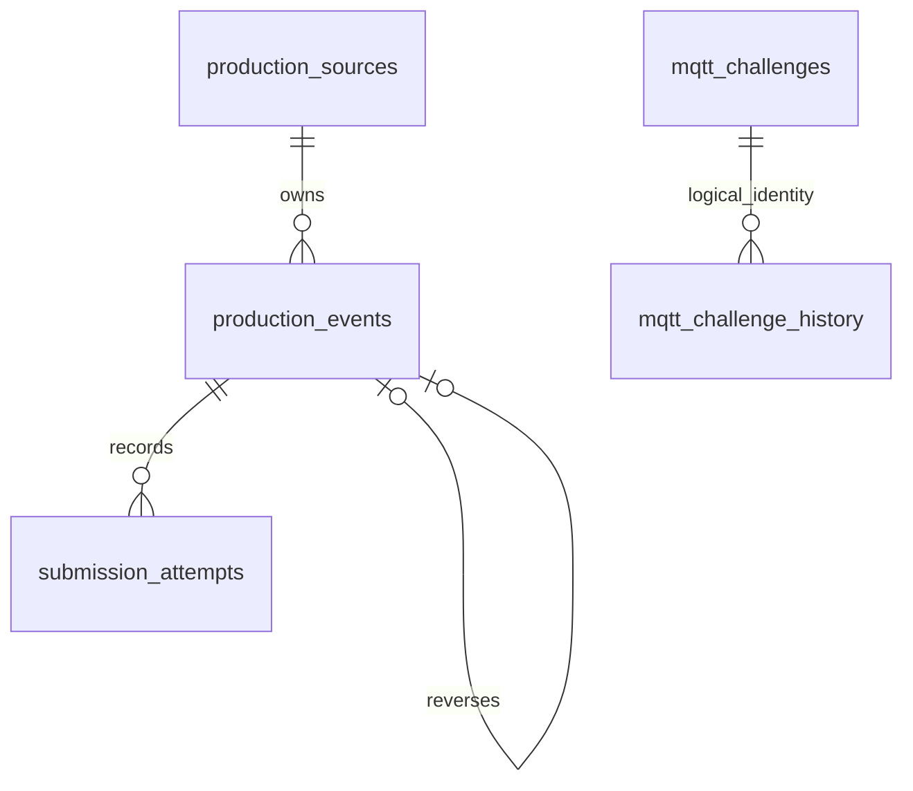

Architecture and decisions
Modules and data
One Express process owns HTTP, the MQTT worker and the production frontend. One PostgreSQL database owns all production state. The separate test database is used only for verification.
`modules/events`: Zod validation, canonical normalization, COUNT/VOID orchestration, per-source locks and pending resolution. `processEvents` is shared by REST and MQTT; routes contain no SQL.
`modules/ack`: durable ACK service and its repository.
`modules/state`: repository queries for summary, pending and exceptions.
`modules/mqtt`: challenge validation/replay service, durable response repository and transport worker.
`modules/audit`: immutable submission attempt repository. A submitted item always gets an attempt, including invalid records without an event row.
`shared/db`: connection pool, bounded transaction retry and ordered migrations with an advisory migration lock.
`frontend`: React state, real API requests, source filters, seven metric cards, review tables and MQTT metadata. No production total is hardcoded.

Sources have a string primary key. Events have an internal bigint key and UNIQUE(source_id,event_id); original JSON, normalized JSON, event time, receipt time, current status/failure, reversal links and ACK time/actor are retained. A VOID's applied_target_id links to its COUNT; the COUNT stores reversed_by. A partial unique index permits only one applied VOID per COUNT. Attempts retain recorded source, supplied identity, optional event link, transport, challenge ID, original/normalized payload and outcome. Challenges own `(candidate_id,challenge_id)`, canonical body, SHA256 digest and serialized original response. Additional history rows capture every challenge arrival/error/conflict/replay and form the publication outbox. The challenge/history relationship is logical, rather than a foreign key, because malformed challenges may have no valid identity.
Transaction and identity strategy
For a batch, validation is performed per item, then all valid production sources are inserted/locked in sorted order. The entire event loop and attempt inserts execute in one PostgreSQL transaction. Row locks serialize changes within a source; composite uniqueness guards event identity, while a unique applied-target index guards reversals. Unexpected SQL errors roll back valid effects and audit writes together. Only PostgreSQL 40001/40P01 are retried, at most two retries after the first attempt. All value-bearing SQL is parameterized.
Canonical comparison sorts object keys and uses a fixed normalized schema: IDs trimmed; omitted optionals become null; event timestamps normalize to UTC milliseconds. Unknown event fields are preserved in original payload but ignored for normalized business identity. New COUNT quantity is an integer from 1 to 500 inclusive, enforced in the shared Zod schema. Existing PostgreSQL constraints and historical rows are retained; direct SQL does not enforce the new upper limit. The same scoped ID and normalized data is DUPLICATE regardless of its current stored business status; changed data is CONFLICT and leaves the original intact.
ACK locks requested IDs in sorted order before processing them in caller order. Repeated IDs see the committed-in-transaction ACK and return ALREADY_ACKED. Missing IDs are NOT_FOUND; unresolved/rejected events are NOT_READY. Completed VOID records are eligible, though usually already auto-ACKED. Reversal never checks ACK, preserving correction eligibility.
The brief conflicts between global event identity and a composite database constraint. Composite identity is authoritative. An unqualified ACK with more than one matching source returns NOT_READY and explicitly requests `source_id`; the optional source-qualified extension and dashboard grouping remove ambiguity. Sources are filtered using stored events/attempt sources. Invalid source-less attempts are shown only without a source filter.
Pending VOID resolution
A valid VOID whose target COUNT is not yet stored is PENDING_REFERENCE; a missing target_event_id is rejected by validation. The pending event is excluded from totals and ACK eligibility. Arrival of a COUNT queries waiting references in internal identity order while holding the source lock. The earliest stored pending VOID is applied and auto-ACKED; other waiting VOIDs are marked REJECTED with reasons. The original pending submission attempts remain immutable, while event rows expose final resolution status. Future VOIDs targeting a reversed COUNT are REJECTED. References to an ID that later proves to be a VOID are rejected. Self-reference is rejected immediately.
`net_total` sums accepted COUNT quantities whose reversed_by is null. `processed_events` counts completed events, including reversed COUNTs and their applied VOIDs. `pending_ack` counts completed rows lacking ACK; `unresolved` counts pending rows; duplicates/conflicts count attempts. A reversed COUNT remains eligible for supervisor review and ACK. Summary uses one SQL statement and a single PostgreSQL statement snapshot; no memory counters are used.
MQTT replay, retry and restart
The service takes a transaction advisory lock keyed by candidate/challenge identity before looking up the original response. Identical canonical challenge bodies return the stored original JSON; changed bodies produce durable conflict history. For a fresh valid challenge, shared event processing, the seven-field summary for newly processed challenges, original response and history/outbox record commit together. Broker publication happens afterward. Therefore a crash before commit has no business effects; a crash after commit republishes committed response data on restart. A crash after PUBACK but before marking publication can cause duplicate responses, but never duplicate production effects. Exactly-once transport delivery is not claimed.
Every challenge response, including identity-less validation failures and conflict responses, has durable history/outbox tracking. The worker serializes its asynchronous transport work, awaits QoS1 PUBACK with a timeout, records publication failures, and flushes unpublished responses after reconnect and during heartbeats. It uses MQTT 3.1.1, clean sessions, 1–30 second exponential reconnect backoff and resubscription. The persisted last challenge survives process restart; live connection state honestly resets to disconnected/disabled. No candidate ID is embedded in application code.
The original response state is a database snapshot at processing time. A replay intentionally returns that same snapshot even when later production changes exist. Replay precedes expiration checks. Internal processing failures are rolled back and durable FAILED / INTERNAL_ERROR history is recorded in a separate transaction; they are not cached as successful original challenges, so a retry may process after the underlying failure is repaired. If PostgreSQL itself is unavailable, durable recording cannot succeed; reconnect/retry requires restored storage.
Contradictions and assumptions
Batch validation is per-record as required by the detailed contract: valid siblings commit, invalid siblings receive durable REJECTED attempts. Unexpected transaction errors roll back the batch. A top-level object with missing fields remains an interpretable event request and gets an individual rejection; scalar/null top levels are HTTP 400.
Results reflect each item's processing instant, in input order. A pending VOID earlier in the same batch may return PENDING_REFERENCE even when a later COUNT resolves it before commit; `/api/state` reports its final status.
Completed VOID counts as processed and automatically acknowledged. Reversed COUNT retains its ACK workflow. Thus one corrected COUNT can produce net zero, processed two, pending ACK one.
The challenge expiration field is `expires_at`; it is optional in the supplied contract, validated/enforced when present. No unsigned issued_at/TTL convention was invented.
The seven domain indicators live under `summary` in REST and under `state` in MQTT. Extra MQTT metadata sits outside the seven indicators.
Event identity strings are trimmed and bounded to 200 characters; candidates are restricted to topic-safe letters/numbers/underscore/hyphen.
Rejected structurally valid VOID events reserve their scoped event ID. Reusing it with different normalized data is CONFLICT. Structurally invalid submissions do not create/reserve event rows.
Examiner walkthrough: one event from input to durable state
A supervisor submits one event or a batch through `POST /api/events` (`backend/app.ts`); an MQTT challenge enters through `backend/modules/mqtt/worker.ts` and `service.ts`. Both paths call `backend/modules/events/service.ts:processEvents`.
`events/schema.ts` validates each record and normalizes its identity/payload. `events/repository.ts` locks source rows in sorted order to serialize competing updates. Within one PostgreSQL transaction, `processEvents` inserts events, detects DUPLICATE/CONFLICT, resolves pending VOID references, and writes each submission attempt through the audit repository.
`GET /api/state` queries `backend/modules/state/repository.ts`, returning seven durable domain indicators. `POST /api/ack` calls the separate ACK service and records acknowledgements without preventing later corrections. The React client calls these same APIs rather than maintaining production totals locally.
For MQTT, the challenge service persists the correlated response and outbox record together with event effects. The worker then publishes with QoS 1; a duplicate challenge reuses its stored response instead of processing the event twice.
Explain with numbers: COUNT +5 creates net_total 5. The identical COUNT is a DUPLICATE and keeps 5. A valid VOID of that COUNT applies one reversal and makes net_total 0. If the VOID arrived first, it would remain PENDING_REFERENCE and resolve on the later COUNT. Completion and supervisor acknowledgement are distinct concepts.
Assessment evidence and handoff gaps
Codex's recorded test evidence includes 16 PostgreSQL integration tests, two browser checks, and local MQTT replay/restart tests. Live examiner-broker connectivity and empty-batch response/replay were observed, but a successful examiner-issued nonempty challenge is not established. Screenshots of the REST API test results and a successful nonempty MQTT challenge should be added if available, since the original assessment asks for dashboard, REST, and MQTT screenshots. The real AI conversation export and GitHub remote/push are separate mandatory handoff checks where requested by the examiner. See `FINAL_SUBMISSION_AUDIT.md` and `AI_USAGE.md` for current truthful status; do not describe these gaps as passed merely because local tests succeed.
Limits and future separation
This local assessment lacks auth, CSRF/session design, TLS termination, rate limits, pagination, retention and monitoring. The supplied plain MQTT broker carries synthetic assessment data. The HTTP listener binds to loopback. Browser fonts have system fallbacks if Google Fonts is unavailable. Large bigint aggregates are returned as JavaScript numbers; deployments exceeding Number.MAX_SAFE_INTEGER should switch to a string/decimal wire contract. Lists are unpaginated and JSON bodies are limited to 1 MB. Heartbeats publish independently of the processing queue at a 25-second interval; network outages can prevent delivery. Only one MQTT worker per candidate should run; multi-instance leader election/leased outbox claiming is future work. Cross-source summaries can include concurrent committed changes from other sources at the query's snapshot.
Modules have repository/service boundaries rather than independent databases. Future migration should first define versioned event/ACK/query contracts, move MQTT ingestion behind a durable queue, retain the transactional event owner, and add an outbox for emitted domain events. Then move audit/reporting into consumers with idempotent inboxes and explicit consistency guarantees. Do not split COUNT and VOID across independently updated stores: target resolution and reversal uniqueness need one authoritative transaction owner.
Reference API behavior was checked against the official MQTT.js documentation and Vitest guide; installed versions are pinned by `package-lock.json`. Actual verification is recorded separately.
## Official change request implementation

- `backend/modules/events/schema.ts:eventSchema` now validates COUNT as an integer in inclusive range 1–500 with a clear COUNT-specific error. `normalize` is still invoked by `events/service.ts:processEvents`; neither REST (`backend/app.ts`) nor MQTT (`mqtt/service.ts:handleChallenge`) has a separate quantity rule. Invalid items still use `audit/repository.ts:recordAttempt`, retain usable source IDs and cannot create accepted events or production effects.
- `backend/modules/state/repository.ts:summary` adds a seventh parameterized SQL subquery counting submission_attempts.status = REJECTED, using the same optional source filter. It counts attempts, not event IDs or rejected event rows. Pending-to-rejected automatic resolution alone does not increment this metric, because its original attempt remains PENDING_REFERENCE. Repeated invalid submissions each increment it; duplicate/conflict/pending attempts do not.
- `mqtt/service.ts:handleChallenge` is unchanged. Its existing call to the shared summary function produces seven fields for new challenges. Replay lookup still happens first and returns the originally persisted response. Historical six-field responses and their stored state are never rewritten; a previously accepted historical COUNT above 500 can still appear in historical replay/production totals.
- `frontend/src/main.tsx` extends Summary/labels with rejected_submissions, displays the backend value in Rejected Submissions, and reuses encoded source filtering. `applySource` invalidates earlier fetches and clears old metrics/rows/results/ACK selections on a changed source; busy filter operations are disabled. Clear filter shows all sources. Manual and 10-second periodic refresh use real API data. `frontend/src/style.css` accommodates seven cards and gives rejections distinct styling while retaining desktop/mobile breakpoints.
- No new API, migration, microservice or project replacement was introduced. Existing COUNT/VOID locking, duplicate/conflict comparison, ACK and response-outbox behavior remain owned by their existing services. Playwright's `scripts/browser-server.ts` helper reuses the dedicated test-database guard and starts an isolated test instance on 3101; this is test infrastructure, not a new application architecture.

The seven indicators are net_total, processed_events, pending_ack, unresolved, duplicates, conflicts and rejected_submissions. All are derived from PostgreSQL. Only REJECTED submission attempts contribute to the new metric; exception display rows may contain both events and attempts without changing the metric count.

The existing six-field FINAL_SUBMISSION_AUDIT.md describes the pre-change revision. CHANGE_REQUEST_VERIFICATION.md records the current checks and limitations. Candidate/examiner independent verification is separate from Codex-run tests; live nonempty examiner processing and the credential-history concern are not resolved by this change request.

Current read-only production evidence observed during the change request: candidate 18 already has CH-18-d1124f338f, processed at 2026-10-09T08:12:00Z, COMPLETED with two events (one ACCEPTED and one REJECTED) and published_at recorded. It predates this feature and retains its original six-field response. This updates the earlier audit's empty-only snapshot, but the database does not independently prove who issued the challenge. No new live seven-field examiner scenario was intentionally sent or verified during this change; the new protocol behavior was executed against local Mosquitto. Candidate/examiner-origin confirmation remains separate from persisted processing evidence.
